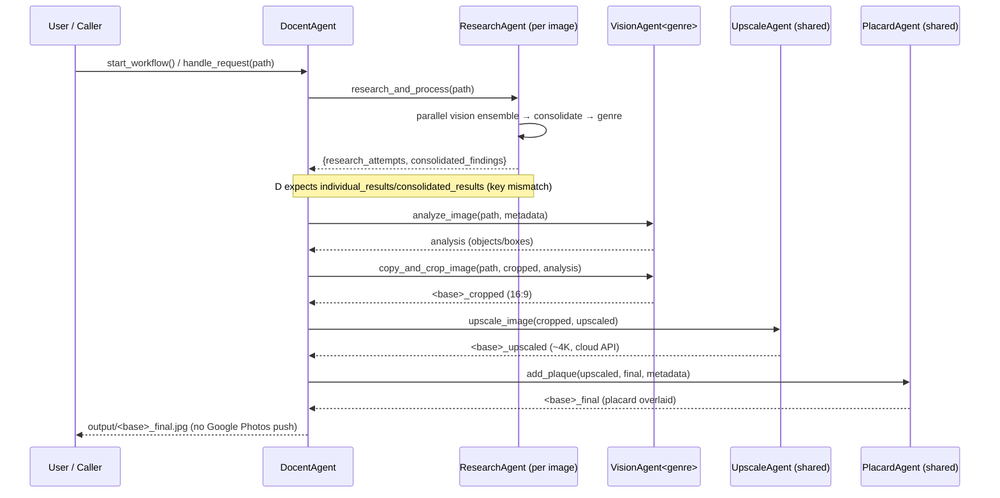

# neural-canvas — System Architecture & Pipeline (Reconstruction)

**Document:** `02_architecture.md` (Phase A reconstruction, ticket A3)
**Scope:** Reverse-engineered from source under `art_agent_team/` plus `Art_Agent_Team_Implementation_Plan.md` and `Art_Agent_Team_Prompt_Design.md`.
**Method:** Code is the source of truth. Where the code diverges from the planning docs, the code is documented as *actual* and the divergence is flagged. Deeper status/risk analysis is deferred to `03_status_and_roadmap.md` (A4) and `04_adversarial_review.md` (A5).

---

## 1. System Overview

neural-canvas (internally "AI Art Team" / "Art Agent Team") is a **modular, agent-based image-processing pipeline** that turns a raw artwork image into a display-ready asset: it researches the artwork's identity/metadata, intelligently crops it to a 16:9 aspect ratio, upscales it toward 4K, and overlays a museum-style placard.

The system is organized as one **orchestrator** (`DocentAgent`) coordinating four **worker agent families**:

| Stage | Agent | Responsibility |
|-------|-------|----------------|
| 1. Identification | `ResearchAgent` | Multi-model vision ensemble → consolidated artwork metadata + genre |
| 2. Vision / Cropping | `VisionAgent*` (9 genre subclasses + `DefaultVisionAgent`) | Genre-aware object analysis → crop to 16:9 |
| 3. Upscaling | `UpscaleAgent` | Upscale cropped image toward 4K via external APIs |
| 4. Placard | `PlacardAgent` | Render + overlay museum-style metadata plaque |
| 5. Delivery | *(none)* | **Not implemented** — see §9. Final image is saved to a local output folder. |

**Language / stack:** Python 3.8+, Pillow (PIL) for all raster work, NumPy, `requests`. External intelligence comes from cloud LLM/vision providers (xAI Grok, OpenRouter, Google Vertex AI / Gemini) and cloud upscaling services (image-upscaling.net, Stability AI). There is no local ML model in the runtime path.

---

## 2. The Two Paradigms

The product docs describe two usage paradigms. In the **current code** they map to two entry points on the same orchestrator, sharing the entire agent layer:

### 2a. Interactive workflow — `DocentAgent.start_workflow()`
- Driven by `main.py` and `run_docent_mvp.py`.
- Scans `input_folder` for supported images (`.png/.jpg/.jpeg/.bmp/.gif/.tiff/.webp`).
- Presents a **numbered CLI menu** (1=Research, 2=Vision, 3=Upscale, 4=Placard, 5=Full) and reads `input()`.
- Processes each discovered image **sequentially** through the user-selected stages.
- **Reality check:** this is a *numbered-menu* CLI, **not** the free-form conversational "chat docent" described in `Art_Agent_Team_Prompt_Design.md` (`docent_persona_prompt`) and the product vision. The persona prompt and the natural-language "adaptive workflow" capability are **not wired into** `start_workflow()`.

### 2b. Programmatic workflow — `DocentAgent.handle_request(task_description, image_path)`
- Non-interactive single-image path used by tests/other agents.
- Forces the **full** pipeline (research → vision → upscale → placard).
- Returns a structured dict: `{"final_image_path": <path>, "metadata": {...}}` (metadata includes `called_agents_workflow`).

Both paradigms run the **identical** stage logic and agent interfaces; they differ only in stage *selection* (menu vs. hard-coded full) and *return contract* (console/files vs. dict). This is the primary point of component sharing (§8).

---

## 3. Orchestration Layer — `DocentAgent`

File: `art_agent_team/docent_agent.py` (~1,130 lines).

### 3.1 Construction & configuration
- `DocentAgent(config_path='art_agent_team/config/config.yaml')`.
- `_load_config()` parses YAML and **promotes API keys to environment variables** (`GOOGLE_API_KEY`, `GROK_API_KEY`, `OPENAI_API_KEY`), so downstream agents can read them from either `config` or `os.environ`.
- Creates `input_folder`, `workspace_folder`, `output_folder` (defaults `input/`, `workspace/`, `output/`).
- Instantiates **stateless** agents once and holds them: `self.agents = {'upscale': UpscaleAgent(config), 'placard': PlacardAgent(config)}`.
- Loads the genre→class map `vision_agent_classes` (from `agents/__init__.py`).
- `ResearchAgent` is **instantiated per image** inside the loop (it carries per-image state / a random `agent_id`), unlike the shared upscale/placard agents.
- Initializes a Markdown workflow log (`logs/docent_workflow_log.md`), rewritten per run, appended at every stage via `_log_to_markdown` / `_format_log_entry`.

### 3.2 Execution model — sequential, not threaded
- **Key architectural fact:** line 59 — *"Queues removed for sequential processing."* The closing comment (line 1131) confirms the worker methods (`_initial_image_processor`, `_upscale_worker`, `_placard_worker`) were **removed**.
- Each image is processed start-to-finish before the next; each stage runs in-line.
- **Divergence:** the Implementation Plan specifies a threaded, queue-based handoff (`upscale_input_queue`, `placard_input_queue`, thread-safe coordination). The shipped code abandoned that for a simpler sequential loop. (`ResearchAgent` still uses threads *internally* for its parallel model calls — §5.1.)

### 3.3 Per-image state machine
For each image the orchestrator threads a small mutable state forward:
- `current_image_path` — advances as each stage emits a new file (original → `_cropped` → `_upscaled` → `_final`).
- `metadata: Dict` — populated by Research, consumed by Vision (analysis hint) and Placard (text content).
- `genre: str` — derived from research metadata (default `'Default'`); selects the VisionAgent subclass.
- `analysis_results` — Vision analysis output, passed into the crop call.

**Stage resilience:** every stage is wrapped in try/except. On failure or invalid output, the orchestrator logs the error and **continues with the previous `current_image_path`** rather than aborting the image. Missing-input guards (`os.path.exists`) precede Upscale and Placard.

### 3.4 Intermediate file naming & cleanup
- Crop → `workspace_folder/<base>_cropped.<ext>`
- Upscale → `workspace_folder/<base>_upscaled.<ext>` (strips `_cropped` to avoid suffix stacking)
- Placard → `output_folder/<base>_final.<ext>` (strips `_upscaled`/`_cropped`)
- If `config.cleanup_workspace` (default `True`), intermediate workspace files are deleted after a successful placard step (cleanup is active in `start_workflow`; in `handle_request` it is stubbed/`pass`).

### 3.5 Dormant orchestration features
- `_think_with_grok()` — calls Grok (`grok-3-mini-fast-high-beta`) for "internal reasoning"; output is **logged only**, never alters control flow.
- `_refine_agent_input_with_grok()` — designed to generate per-stage refined parameters (focus_areas, upscale_model, placard_style …) from previous results + user context. It is **defined but never invoked** by `start_workflow()` or `handle_request()`. The inter-agent refinement loop described in the Prompt Design doc is therefore latent/unused in the live path.

---

## 4. End-to-End Pipeline (data & control flow)

```
                         ┌─────────────────────────────────────────────┐
   input/ (images)  ───▶ │              DocentAgent                     │
                         │  (orchestrator: sequential, per-image loop)  │
                         └─────────────────────────────────────────────┘
                                          │  per image, selected stages
                 ┌────────────────────────┼───────────────────────────┬───────────────────────┐
                 ▼                        ▼                            ▼                       ▼
        ┌─────────────────┐     ┌───────────────────┐       ┌──────────────────┐    ┌──────────────────┐
        │  ResearchAgent  │     │   VisionAgent<G>   │       │   UpscaleAgent   │    │   PlacardAgent   │
        │ (per image)     │     │ (genre-selected)   │       │ (shared)         │    │ (shared)         │
        ├─────────────────┤     ├───────────────────┤       ├──────────────────┤    ├──────────────────┤
        │ multi-model     │     │ analyze_image()    │       │ upscale_image()  │    │ add_plaque()     │
        │ vision ensemble │     │  → objects/boxes   │       │  → cloud upscale │    │  → text + overlay│
        │ → consolidate   │     │ copy_and_crop_     │       │   (≈4K target)   │    │   lower-right    │
        │ → metadata,genre│     │  image() → 16:9    │       │                  │    │                  │
        └─────────────────┘     └───────────────────┘       └──────────────────┘    └──────────────────┘
                 │  metadata,genre        │  _cropped.jpg              │  _upscaled.jpg        │  _final.jpg
                 └───────────────┬────────┴───────────────┬────────────┴───────────┬───────────┘
                                 ▼                         ▼                        ▼
                          genre selects             current_image_path      metadata supplies
                          VisionAgent subclass       advances each stage     placard text
                                                                                     │
                                                                                     ▼
                                                                            output/<base>_final.jpg
                                                                            ( ✗ Google Photos delivery
                                                                              NOT implemented )
```

**Control flow (full workflow), per image:**
1. **Research** → `ResearchAgent(config, vision_agent_classes).research_and_process(path)` → metadata + `genre`.
2. **Vision** → select `vision_agent_classes[genre]` (fallback `Default`); `analyze_image(path, metadata)` then `copy_and_crop_image(in, cropped_out, analysis)`; advance path.
3. **Upscale** → `self.agents['upscale'].upscale_image(in, upscaled_out)`; advance path.
4. **Placard** → `self.agents['placard'].add_plaque(in, final_out, metadata)`; advance path; optional cleanup.
5. **Delivery** → save to `output_folder`. *(No push to Google Photos / digital frame — vision goal only.)*

**Data contract threading the pipeline:** the `metadata` dict is the spine — produced by Research, used by Vision (as an analysis hint) and Placard (as text). `genre` is the routing key that makes the pipeline genre-aware. `current_image_path` is the moving cursor of the image artifact.

---

## 5. Agent Responsibilities & Interfaces

### 5.1 ResearchAgent — identification & metadata
File: `agents/research_agent.py` (~1,400 lines). Constructed as `ResearchAgent(config, vision_agent_classes)`.

**Internal structure:**
- **`ModelRegistry`** — initializes and holds provider clients and a capability registry:
  - **xAI Grok** (OpenAI-compatible, `https://api.x.ai/v1`)
  - **OpenRouter** (`https://openrouter.ai/api/v1`)
  - **Google Vertex AI** (`vertexai` SDK; `GenerativeModel`, thread-locked client creation)
  - Registers models by capability (`vision` / `text`) and provider. Model IDs are **pinned** ("DO NOT CHANGE"): OpenRouter Llama-Maverick / Llama-Scout / Qwen2.5-VL / InternVL / Mistral3 / Gemma3; Gemini-2.5-Pro-exp & Gemini-2.0-Flash-exp (Vertex); Grok-2-vision-1212; consolidation = `grok-3-mini-fast-high-beta`.
- **`PromptTemplate`** — loads art-movement reference data, the master vision prompt, and the consolidation prompt; validates date↔movement consistency.

**Core flow** (`research_and_process` → `unified_research`):
1. `_preprocess_input(path)` — filename tokenization, image bytes, MIME type.
2. `_execute_parallel_searches(vision_models, …)` — runs the vision models **concurrently** (thread pool, `max_concurrent_calls` default 5, per-call timeout 120s, retries via `_make_llm_call_with_retry`). Each model returns structured JSON (author, title, date, nationality, style, movement, subjects, confidence, grounding…).
3. `_consolidate_results(individual_results)` — synthesizes one record with `CONSOLIDATION_MODEL` (Grok), re-validating date/movement.
4. `categorize_artwork()` — separately refines `movement`/`style`→`genre` via Grok against the movement list (genre feeds VisionAgent selection).
- **Output (actual):** `{"research_attempts": {...}, "consolidated_findings": {...}}`.
- ⚠️ **Contract mismatch:** `DocentAgent` reads `research_output["individual_results"]` and `["consolidated_results"]` — the **old** key names. `unified_research` now returns `research_attempts` / `consolidated_findings`. In the orchestrator path this makes the research output look "invalid," falling back to empty metadata + `Default` genre. (`categorize_artwork` tolerates both keys; `DocentAgent` does not.) Evidence: `docent_agent.py` lines 283–284, 393; `research_agent.py` lines 614–617. Flagged here as a data-flow defect; severity assessed in A4/A5.

### 5.2 VisionAgent family — analysis & cropping
Files: `agents/vision_agent_abstract.py` (base) + 9 concrete subclasses; map in `agents/__init__.py`.

**Genre → class registry** (`vision_agent_classes`):
`Default→DefaultVisionAgent`, `Landscape`, `Animal`, `Portrait`, `Still Life`, `Figurative`, `Genre Scene→VisionAgentGenre`, `Religious/Historical`, `Surrealist`. Unmapped genres fall back to `Default`.

**Orchestrator-facing interface (the contract DocentAgent actually calls):**
- `__init__(config)`
- `analyze_image(image_path, metadata) -> dict | None` — genre-tuned object/feature detection (e.g., Portrait localizes faces/features), returns objects with normalized `[y0,x0,y1,x1]` boxes (Gemini/Grok-vision style).
- `copy_and_crop_image(input_path, output_path, analysis_results) -> output_path` — produces the 16:9 crop preserving key elements (Default falls back to a **center** 16:9 crop).

**⚠️ Dual-interface divergence:** `VisionAgentAbstract` defines a *different* contract — an abstract `_perform_specific_analysis(...)` plus `process()` / `generate_outputs()` built around Google-Cloud-Vision-style `BoundingBoxRegion` / `SegmentationMask` dataclasses and visualization/crop helpers. The orchestrator never calls `process()`; it calls `analyze_image()` / `copy_and_crop_image()`, which the concrete agents implement directly. `DefaultVisionAgent` does **not** implement the abstract `_perform_specific_analysis`, so the ABC and the live interface have drifted apart (the base class's analysis/segmentation machinery is effectively a parallel, partly-unused subsystem). Recorded as an architectural inconsistency for A4/A5.

### 5.3 UpscaleAgent — resolution enhancement
File: `agents/upscale_agent.py`. Constructed as `UpscaleAgent(config)`; shared singleton.

- **Interface:** `upscale_image(input_path, output_path, target_width=3840, target_height=2160) -> path | None`.
- **Providers (cloud, not local):**
  1. **image-upscaling.net** via the `image_upscaling_api` package — upload (`scale=4`), poll for completion (≤300s), download result. Requires `image_upscaling_id`.
  2. **Stability AI** fast upscaler (`/v2beta/stable-image/upscale/fast`) — requires `stablediffusion_api_key`; pre-resizes inputs above the 1,048,576-pixel API limit (LANCZOS).
- **Selection:** `upscaler_preference` ∈ `{image_upscaling_net, stability_ai, fallback}`. `fallback` tries image-upscaling.net then Stability AI. If neither key is present, upscaling is unavailable (agent no-ops with errors).
- **⚠️ Divergence:** the Implementation Plan specified **local ESRGAN** (TensorFlow/PyTorch, 8GB VRAM). The shipped agent **pivoted to external APIs**; ESRGAN/`torch` code is commented out and absent from `requirements.txt`.

### 5.4 PlacardAgent — museum-style label overlay
File: `agents/placard_agent.py`. Constructed as `PlacardAgent(config)`; shared singleton.

- **Interface:** `add_plaque(input_path, output_path, metadata) -> path | None`.
- **Process:** load a card-stock background (`input/card_stock.jpg`; white fallback if missing) → resize the plaque to **~5% of artwork width** → render metadata text (`title`, `author`, `date`, `nationality`, `style`) with **dynamic font-fitting** (shrink-to-fit + `textwrap`, bold title) → overlay onto the artwork with configurable opacity → save RGB.
- **Positioning:** `_find_optimal_plaque_position()` is a **TODO stub** that always returns the **lower-right** corner with a margin; "smart" low-detail placement is not implemented.
- Uses `_think_with_grok()` for "reasoning" (logged only).
- **⚠️ Divergences/notes:** plan called for plaque width 20–30% of image (code uses 5%); `add_plaque` references an undefined local `genre` (lines ~139) inside a broad try/except, so it degrades to "background only" rather than crashing; metadata key naming is inconsistent across the codebase (`author` vs `artist`).

---

## 6. External Dependencies & Configuration

- **Imaging:** Pillow, NumPy, OpenCV (optional).
- **LLM/Vision providers:** `openai` (Grok + OpenRouter, OpenAI-compatible), `google-cloud-aiplatform`/`vertexai` (Gemini), `google-generativeai`, `google-cloud-vision` (declared; fallback/auxiliary), `google-api-python-client` (Search grounding).
- **Upscaling:** `image_upscaling_api`, plus Stability AI over `requests`.
- **Configuration (`config.yaml`, user-supplied — not in repo):** API keys (`grok_api_key`, `openrouter_api_key`, `google_api_key`, `google_credentials_path`, `image_upscaling_id`, `stablediffusion_api_key`), Vertex (`vertex_project_id`, `vertex_location`), folders (`input/output/workspace`), and agent knobs (`upscaler_preference`, `placard_agent.*`, `cleanup_workspace`, concurrency/timeout). Keys are loaded and exported to `os.environ` at startup.

**LLM model assignment (per Implementation Plan §LLM Constraints, consistent with code):** Research vision = the pinned vision ensemble; consolidation/communication/"thinking" across agents = `grok-3-mini-fast-high-beta`; Vision analysis = `gemini-2.5-pro-exp-03-25`.

---

## 7. Sequence View (full workflow, one image)



---

## 8. Component Sharing Between Paradigms

- **Single orchestrator, two entry points:** `start_workflow()` (interactive menu) and `handle_request()` (programmatic full run) execute the **same** four-stage logic and call the **same** agent interfaces. They differ only in (a) stage selection and (b) output contract.
- **Shared agent instances:** `UpscaleAgent` and `PlacardAgent` are constructed once and reused across all images and both paradigms (stateless w.r.t. image). `ResearchAgent` is per-image (stateful), and `VisionAgent` is instantiated per-image by genre.
- **Shared config & env-var bootstrap:** one `_load_config()` seeds credentials for every agent and provider.
- **Shared genre registry:** `vision_agent_classes` is the common dispatch table consumed by both paths.
- **Shared logging spine:** the Markdown workflow log records both paradigms identically.

The "interactive chat docent" and "silent watched-folder pipeline" product paradigms therefore collapse, in the current code, onto this one orchestrator + agent layer. The watched-folder behavior is approximated by folder scanning in `start_workflow()`; the conversational docent persona is **not yet implemented** as an interactive loop.

---

## 9. Architectural Findings (divergences from the planning docs)

| # | Finding | Evidence | Plan said |
|---|---------|----------|-----------|
| 1 | **Sequential**, not threaded/queued | `docent_agent.py:59`, closing comment :1131 | Threaded queues `upscale_input_queue`/`placard_input_queue` |
| 2 | Upscaling via **cloud APIs** (image-upscaling.net, Stability AI) | `upscale_agent.py` (ESRGAN commented out); `requirements.txt` (no torch) | Local ESRGAN (TensorFlow/PyTorch, 8GB VRAM) |
| 3 | **Dual VisionAgent interface** — `analyze_image`/`copy_and_crop_image` used; ABC `process`/`_perform_specific_analysis` drifted/unused | `vision_agent_abstract.py` vs `vision_agent_default.py` + `docent_agent.py` calls | Single VisionAgent contract |
| 4 | **Research output key mismatch** breaks metadata handoff to DocentAgent | `research_agent.py:614-617` vs `docent_agent.py:283,393` | Clean metadata handoff |
| 5 | **No Google Photos / delivery** stage | no refs in `art_agent_team/`; pipeline ends at `output_folder` | Final delivery to Google Photos |
| 6 | **Conversational docent persona not wired** into the interactive loop | `start_workflow()` uses numbered menu; `docent_persona_prompt` unused | NL adaptive chat docent |
| 7 | Inter-agent **Grok refinement loop dormant** (`_refine_agent_input_with_grok` never called) | `docent_agent.py` (defined, not invoked) | Context-passing refinement between stages |
| 8 | Placard **smart positioning is a stub** (always lower-right); width 5% vs planned 20–30% | `placard_agent.py:336-348`, :108 | Smart placement, 20–30% width |

These reflect a system that is **architecturally complete in skeleton** (orchestrator + four agents + genre routing + multi-provider research) but where several planned capabilities are stubbed, dormant, or wired with a contract mismatch. The intended architecture and the live architecture agree on **shape**; they diverge on **execution model, upscaler technology, delivery, and several integration contracts**.

---

*End of `02_architecture.md`.*
